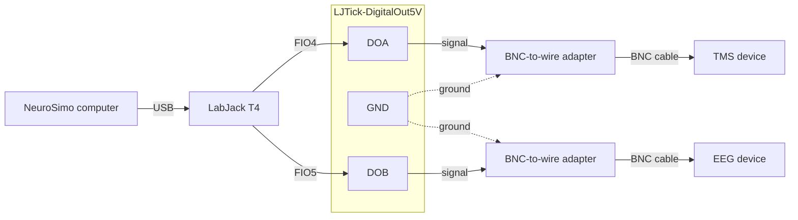

# Hardware configuration guide

## Overview

NeuroSimo supports the following hardware devices:

- **EEG devices**: Bittium NeurOne and BrainProducts actiCHamp Plus (via TurboLink interface)
- **TMS triggering**: LabJack T4 (connected via USB)

## Table of contents

1. [EEG devices](#eeg-devices)
   - [Bittium NeurOne](#bittium-neurone)
   - [BrainProducts actiCHamp Plus (TurboLink)](#brainproducts-actichamp-plus-turbolink)
2. [TMS triggering](#tms-triggering)

## EEG devices

### Bittium NeurOne

Configuring the real-time streaming from the NeurOne to NeuroSimo consists of two steps: configuring the NeurOne and configuring the computer on which NeuroSimo is installed.

#### NeurOne settings

Configure the general NeurOne settings as follows:

- Open "Settings" tab in the NeurOne software.
- Under both the Trigger A and Trigger B tabs, set the trigger type to "Stimulus Trigger".

Configure the protocol settings as follows:

1. Go to the "Protocol" tab in the NeurOne software, select the protocol, click "Edit", select "Real-time Out" tab, and then "Settings" under the tab.
2. Set the Packet Frequency (Hz) equal to the sampling frequency of the EEG data.
3. Set "Target IP Address" to 192.168.200.254 and "Target UDP Port" to 50000.
4. Enable "Send Triggers as Channels" and "Send Packets MeasurementStart and MeasurementEnd".
5. Disable the other checkboxes.
6. Click "Ok" to save the settings.

#### Computer settings

Configure the computer on which NeuroSimo is installed as follows:

1. After connecting the EEG device to the computer via Ethernet cable, open the "Network" settings of the computer.
2. Select the Ethernet connection and click on "Properties".
3. Select the "IPv4" tab and set the "IP address" to 192.168.200.254 and "Subnet mask" to 255.255.255.0.
4. Click "OK" to save the settings.
5. Restart the computer.

To test the connection, start streaming the EEG data from the NeurOne, start a session in NeuroSimo, and check that
the EEG indicator is green in the top-right corner of the panel in the user interface.

### BrainProducts actiCHamp Plus (TurboLink)

TBD.

## TMS triggering

LabJack T4, connected to the computer via USB, is used to trigger the TMS device. It also sends a loopback trigger to
the EEG device, which NeuroSimo uses to measure the latency of the pipeline.

### Required hardware

For one LabJack installation:

| Component | Quantity | Notes |
|---|---|---|
| [LabJack T4](https://labjack.com/products/labjack-t4) | 1 | |
| [LJTick-DigitalOut5V](https://labjack.com/products/ljtick-digitalout5v) | 1 | Converts the 3.3 V digital outputs to 5 V |
| Male BNC-to-wire screw-terminal adapter | 2 | For example, [this one](https://www.amazon.de/dp/B0B97D3WQJ) on Amazon; equivalent adapters from other suppliers are suitable |
| BNC cable | 2 | Connectors and lengths to suit the TMS device, the EEG device, and their placement |

### Connections

1. Plug the LJTick-DigitalOut5V directly into the LabJack T4's **FIO4/FIO5/GND/VS** terminal block.
2. Connect two BNC-to-wire adapters to the LJTick's output terminals:
   - **DOA + GND** → TMS device (trigger)
   - **DOB + GND** → EEG device (loopback trigger)
3. Connect each adapter to its respective device using a BNC cable.

The LJTick converts the LabJack's 3.3 V digital signals to 5 V. See the [LJTick-DigitalOut5V datasheet](https://support.labjack.com/docs/ljtick-digitalout5v-datasheet) for details.

Solid lines carry the signal and dashed lines are ground connections.

### Verification

After LabJack T4 is connected to the computer via USB, it is automatically detected by NeuroSimo when a session is
started. LabJack is enabled by default; if no triggers are sent, check that 'Settings...' -> 'LabJack' ->
'Enable LabJack' is selected.

The setup can be checked by selecting 'example' decider in the user interface, setting up the EEG simulator to stream
data, and pressing 'Start'. It should send triggers to the TMS device every 2 seconds.
